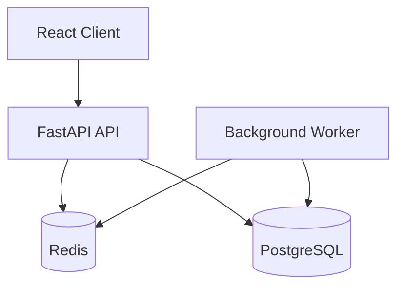

# FlashGuard Architecture

## Conceptual Overview

## Why Redis is used
Redis is used strictly for the "hot path" of inventory reservation. During a flash sale, thousands of users might hit the backend simultaneously. If we used PostgreSQL for the initial inventory decrement:
1. Row-level locks (`SELECT FOR UPDATE`) would bottleneck the database.
2. Race conditions might occur if locks aren't managed perfectly.

Instead, we use a single atomic Redis Lua script. The script checks if inventory is available and decrements it in one non-interruptible operation. This guarantees high throughput and prevents overselling.

## Why PostgreSQL is used
PostgreSQL is the durable source of truth. Redis data can be evicted or lost during crashes. PostgreSQL holds the definitive state of Products, Reservations, Orders, and Payments. The system is designed to recover inventory counts from PostgreSQL if Redis fails.

## How race conditions are prevented
The Redis Lua script takes the requested quantity and the idempotency key. Since Redis executes scripts atomically, no two requests can read the same inventory state simultaneously. The script evaluates both idempotency and inventory rules in a single tick.

## How duplicate requests are handled (Idempotency)
Each purchase request sends a unique `idempotency_key`. The Redis script checks if this key exists. If it does, it rejects the request for new inventory and the backend returns the existing Reservation/Order from PostgreSQL. This ensures users hitting the "Buy" button twice don't consume two units of inventory.

## How inventory is restored
When an order fails payment or a reservation times out:
1. The PostgreSQL state is updated to `CANCELLED` or `EXPIRED`.
2. The inventory count in PostgreSQL is incremented.
3. The inventory count in Redis is incremented.

This operation is isolated to the background worker and the payment cancellation API, ensuring it happens exactly once.

## How failure recovery works
If the FastAPI process dies right after Redis inventory is decremented but before PostgreSQL is updated, that unit of inventory is "lost" in Redis. However, because PostgreSQL is the source of truth, an admin script or periodic reconciliation job can re-sync Redis inventory based on `Product.total_inventory` minus active `Reservations` and `Orders`. The background worker handles timeout-based recovery.
